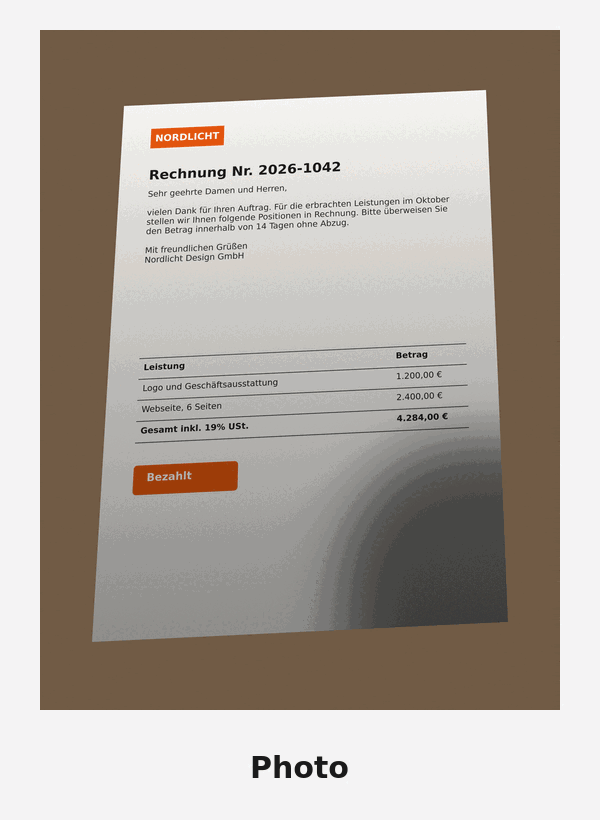
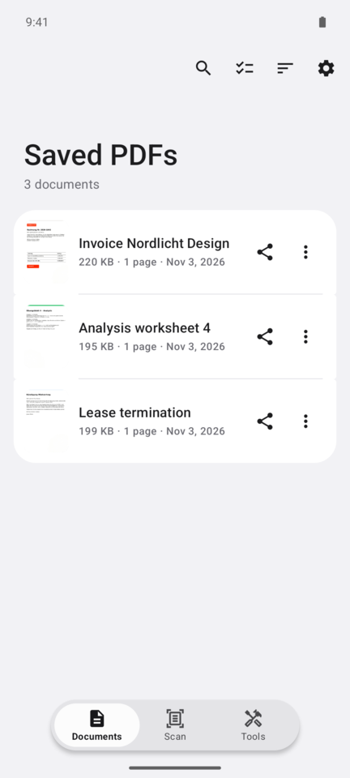
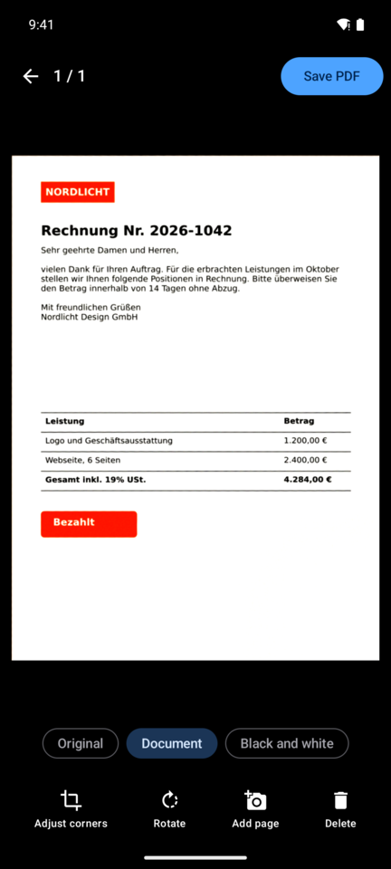
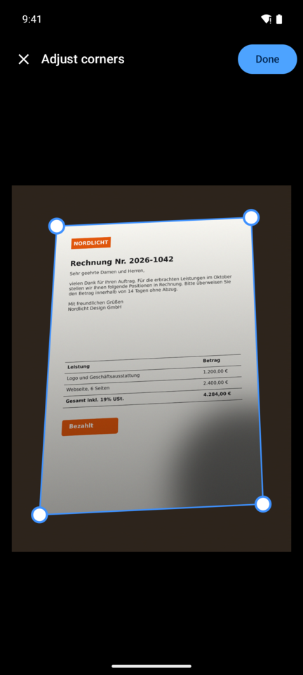
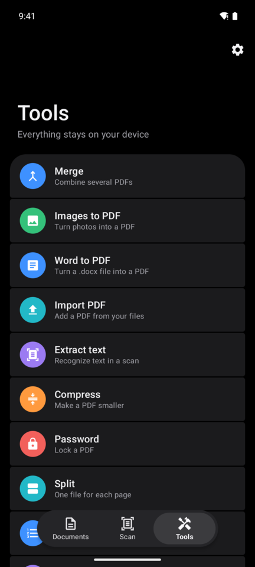
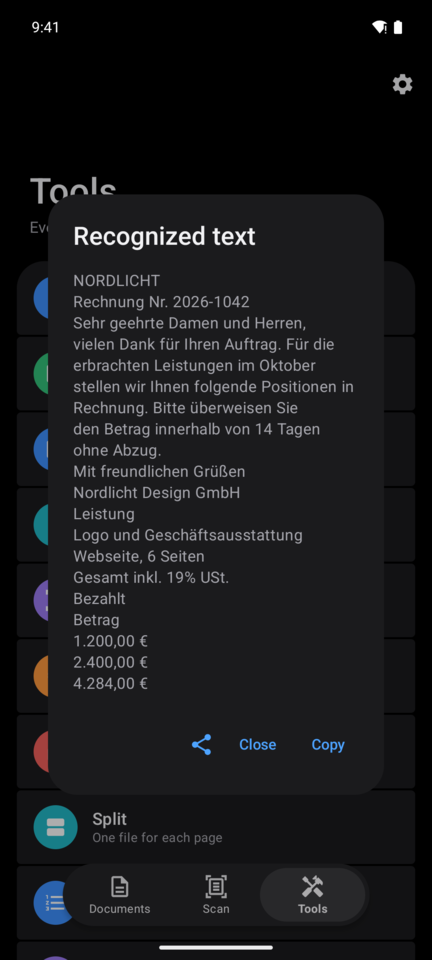
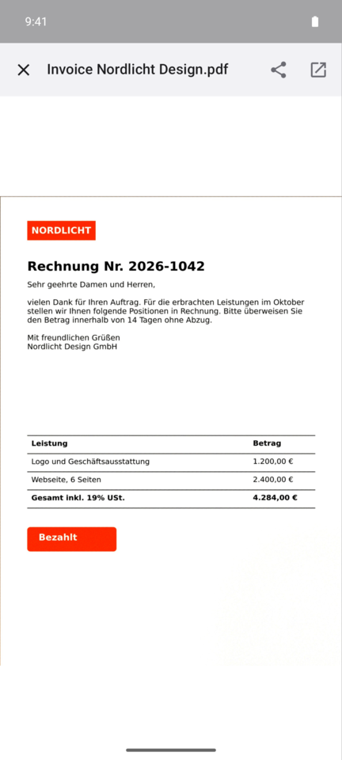

<p align="center">
  
</p>

<h1 align="center">Sheetly</h1>

<p align="center">
  A document scanner for Android without ads, accounts or subscriptions.<br>
  Your scans stay on your phone.
</p>

<p align="center">
  <a href="https://github.com/akuras22/Sheetly/releases/latest"></a>
</p>
<p align="center">
  <a href="https://apps.obtainium.imranr.dev/redirect?r=obtainium://add/https://github.com/akuras22/Sheetly"></a>
</p>
<p align="center">
  
  <a href="LICENSE"></a>
</p>

<p align="center">
  
  <br>
  <sub>A tilted test photo with a hand shadow, and the PDF Sheetly made of it. The photo is a generated test image.</sub>
</p>

## Why Sheetly

- **No ads, no account, no subscription, no watermark.** Every feature is free.
- **Your documents stay on your phone.** Scanning, text recognition and every tool run on the
  device. See the [privacy policy](PRIVACY.md) for the little that does go online.
- **Open source.** You can read, build and check every line yourself.

## Screenshots

<p align="center">
  
  
  
</p>
<p align="center">
  
  
  
</p>

## Features

**Scanning**
- Live edge detection with automatic capture, also for a white page on a white table, a thumb on
  the page or a cut-off corner.
- Corner editor with a magnifier, perspective correction and shadow removal.
- Filters per page: original, document and black and white.
- Selectable, searchable text in every scan.

**Tools**, for your scans and for any PDF from your files
- Merge, split, compress
- Lock with a password (AES-256)
- Extract text, add page numbers or a watermark, print
- Turn images or Word files (.docx) into a PDF
- Reorder, rotate and delete pages without losing quality

**And also**
- Opens PDFs that other apps share with it
- Design in the style of Samsung's One UI, light and dark
- German and English

## Install

**APK:** Download `Sheetly-….apk` from the
[latest release](https://github.com/akuras22/Sheetly/releases/latest) and open it on your phone.
Android asks once whether your browser or file manager may install apps.

**Obtainium:** Tap the badge above, or add `https://github.com/akuras22/Sheetly` in
[Obtainium](https://github.com/ImranR98/Obtainium). It installs Sheetly from the releases here and
keeps it up to date.

Sheetly needs Android 14 or newer. Google Play services are only needed if you switch to Google's
scanner in the settings.

## Privacy

Sheetly has no ads and no analytics or tracking of its own, and it never uploads your documents.
Three things do go online:

- At start, the app asks GitHub whether a new version exists.
- Google ML Kit, which recognizes the text, sends anonymous usage metrics to Google. According to
  Google, images and text are not sent.
- Google's scanner, if you choose it in the settings, runs in Google Play services.

Details are in the [privacy policy](PRIVACY.md).

## Build from source

```bash
./gradlew assembleDebug
```

The APK ends up in `app/build/outputs/apk/debug/`. Unit tests run with `./gradlew testDebugUnitTest`.

GitHub Actions runs the tests and builds an APK on every push to `main`. Pushing a tag like `v2.1`
publishes a signed release.

## How it works

- `scan/DocumentDetector.kt` finds pages by their straight edges instead of a closed outline.
  `DocumentDetectorBenchmarkTest` measures every change against 760 generated scenes in 19 hard
  situations, and currently finds the page in 95.8 % of them.
- `ScanEnhancer.kt` estimates the brightness of the paper across the page and divides it out, which
  removes shadows without washing out photos or coloured areas.
- PDFBox-Android merges and edits PDFs without re-rendering them, so text and quality are kept.

## License

Licensed under the [Apache License 2.0](LICENSE). You may use, change and share this project for
free, as long as you keep the copyright and the [NOTICE](NOTICE) file and mark your changes. It may
not be presented as your own work.
